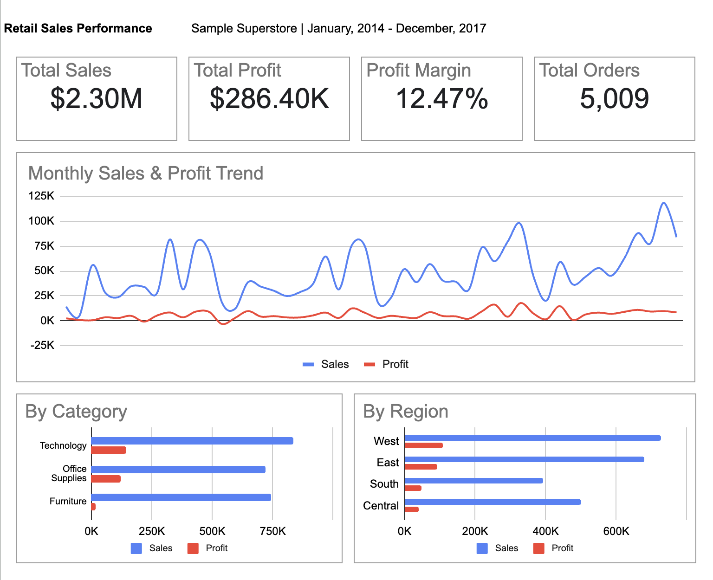

# superstore-sales-profitability-analysis

## Dashboard Preview

## Interactive Dashboard
View the Google Sheets Dashboard

## Business Case

A fictional U.S. retail company sells Furniture, Office Supplies, and Technology products across multiple regions.

Management wants to understand why sales performance does not necessarily translate into profitability and identify which categories and regions require attention.

This project analyzes historical sales and profit data to identify performance gaps and provide actionable recommendations for improving profitability.

## Business Goal

Identify opportunities to improve sales performance and profitability across the retail business.

## Business Questions

- BQ01: How have sales and profit changed over time?
- BQ02: Which product categories contribute most to sales and profit?
- BQ03: Which regions have the highest and lowest profitability?
- BQ04: Do categories and regions with substantial sales also achieve high profit margins?

## Data Source

This project uses the Sample Superstore dataset, containing 9,994 transaction records from 2014 to 2017.

The dataset includes order information, product categories, customer segments, geographic regions, sales, discounts, quantities, and profits.

- **Dataset:** [Sample - Superstore.csv](https://www.kaggle.com/datasets/vivek468/superstore-dataset-final)
- **Source:** Kaggle (originally attributed to Tableau)
- **Data Coverage:** United States, 2014–2017
- **Intended Use:** Educational data analysis and portfolio development
- **License / Redistribution:** Not yet verified

### Data Attribution and Usage

The Kaggle uploader attributes the dataset to Tableau and states that it was shared for educational purposes.

Tableau also provides Superstore sample data through its [official sample data page](https://public.tableau.com/app/learn/sample-data).

The original dataset's redistribution permissions have not been independently verified.

## Methodology

The analysis was conducted in Google Sheets using the following steps:

1. Data Quality Validation: Checked missing values, data types, duplicate Row IDs, and date consistency.
2. KPI Calculation: Calculated total sales, total profit, profit margin, and distinct order count.
3. Trend Analysis: Examined monthly sales and profit trends to identify patterns over time.
4. Category Analysis: Compared sales, profit, and profit margins across product categories.
5. Regional Analysis: Evaluated sales and profitability across geographic regions.
6. Business Interpretation: Identified performance gaps and developed recommendations based on the findings.

## Key Findings

### KF01: Sales Increased, but Profitability Fluctuated

Sales generally increased from 2014 to 2017, while annual profit increased each year. However, the profit margin peaked at 13.43% in 2016 before declining to 12.74% in 2017.

### KF02: Furniture Shows Relatively Weak Profitability

Technology generated the highest sales ($836.2K) and profit ($145.5K), achieving a profit margin of 17.40%.

In contrast, Furniture generated $742.0K in sales but only $18.5K in profit, with a profit margin of 2.49%. Tables and Bookcases recorded losses.

### KF03: Regional Profitability Varies

The West region recorded the highest profit ($108.4K) and profit margin (14.94%).

In contrast, Central generated $501.2K in sales but achieved a profit margin of only 7.92%, the lowest among the four regions.

### KF04: High Sales Do Not Necessarily Indicate High Profit Margins

Furniture and Central demonstrate that substantial sales do not always translate into strong profitability.

These findings suggest that sales performance should be evaluated alongside profit margins when identifying areas for further investigation.

## Recommendations

### R01: Investigate Furniture Profitability 
**Priority: High**
  - Investigate the losses in Tables and Bookcases, focusing on discount rates, pricing, and product performance.

### R02: Investigate Central Region
**Priority: High** 
  - Analyze profitability by state and product category within Central to identify the main sources of low profitability.

### R03: Review High-Sales Periods
**Priority: Medium**
  - Review discount rates and product mix during high-sales months, particularly November, to identify potential reasons for lower profit margins.

## Limitations

- The dataset represents historical sample retail transactions and does not necessarily reflect current market conditions.
- The analysis is descriptive and does not establish causal relationships.
- Discount rates and product mix may contribute to profitability differences, but their causal effects have not been established.
- Recommendations identify areas for further investigation rather than guaranteeing specific financial improvements.

## Verification and Reproducibility

The analysis uses the Sample Superstore dataset linked in the Data Source section.

Key calculations include:

- **Total Sales:** Sum of Sales
- **Total Profit:** Sum of Profit
- **Profit Margin:** Total Profit / Total Sales × 100
- **Total Orders:** Count of distinct Order IDs

Data quality checks include missing values, data types, duplicate Row IDs, and date consistency.

The original Google Sheets workbook is not publicly shared. Readers can obtain the dataset from the linked Kaggle source and independently reproduce the key calculations.

However, the workbook's formulas and intermediate calculations cannot be directly inspected through this repository.

